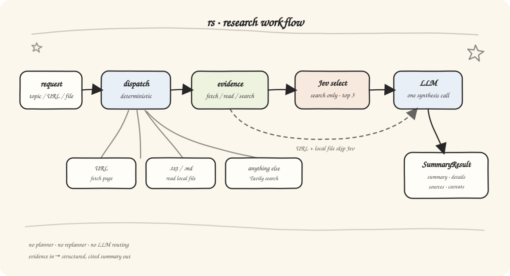

# Research Summarizer Agent

A minimal, local-only research summarizer that accepts a topic, URL, or local text file and returns a structured summary with key details, sources, and caveats.

## Features

- **Web Search**: Searches the web through Tavily for topic research
- **Evidence Selection**: Uses TypeSafe Jev to rank and keep the most relevant search sources
- **URL Fetching**: Reads and summarizes web pages
- **Local File Reading**: Processes local `.txt`, `.md`, or `.markdown` files within the project root
- **Source Attribution**: Python restores source titles and URLs from model-selected source IDs
- **LangSmith Tracing**: Ready for tracing and debugging with LangSmith
- **Multiple LLM Support**: Compatible with OpenAI and DeepSeek models

## How it works

The workflow is intentionally minimal:



Each request makes exactly one synthesis LLM call. Topic searches also make
one Jev judgment call per source (TypeSafe) before synthesis; URL and file
requests skip Jev.
The API keeps its explicit input type when dispatching; the CLI infers a route
from free-form input. Python assigns source IDs to the evidence actually sent to
synthesis. The model selects those IDs and copies short excerpts; Python validates
them and restores the acquired source titles and URLs in the public result.
Local-file results have no web source URLs.
Each summary bullet includes a citation with a short excerpt copied from its
source. The parser checks that every bullet has a citation when evidence is
available, and that each excerpt occurs in the exact source record selected by ID.
For local files, the citation identifies the file without adding a web URL. The UI expands
citations inline; the CLI prints them beneath each bullet.
Off-topic source content still requires citations explaining the mismatch;
only failed acquisition or absent source content permits an empty citation list.

## Installation

Requires Python 3.11+, Node.js/npm, and Make.
The Makefile uses POSIX shell commands and `.venv/bin/` paths;
on Windows, use WSL.

```bash
git clone https://github.com/niko4570/rs.git
cd rs
make install
```

`make install` creates `.venv` and installs the Python package in editable
mode plus frontend dependencies. Configure `.env` as described below before
running a research request.

## Configuration

Copy `.env.example` to `.env` in the project root. Every synthesis provider uses
the same three required variables: `OPENAI_API_KEY`, `OPENAI_BASE_URL`, and
`OPENAI_MODEL`. Set the key and model for your chosen provider:

For OpenAI:

```bash
OPENAI_API_KEY=sk-...
OPENAI_BASE_URL=https://api.openai.com/v1
OPENAI_MODEL=gpt-4o-mini
```

For DeepSeek:

```bash
OPENAI_API_KEY=your-deepseek-api-key
OPENAI_BASE_URL=https://api.deepseek.com
OPENAI_MODEL=deepseek-chat
```

You also need a Tavily key for web search:

```bash
TAVILY_API_KEY=tvly-...
```

And a TypeSafe key for Jev evidence selection on topic searches:

```bash
TYPESAFE_API_KEY=...
# Optional; defaults to jev-latest
TYPESAFE_MODEL=jev-latest
```

If `TYPESAFE_API_KEY` is unset or Jev is unavailable, search evidence is used
as-is (selection is skipped) rather than failing the request.

### Synthesis output format

`OPENAI_OUTPUT_FORMAT=json_object` is the compatibility default. For endpoints that
support strict structured output, set `OPENAI_OUTPUT_FORMAT=json_schema` to request
the internal `SynthesisResult` schema. Unsupported schema requests fail explicitly;
the workflow does not retry with a different format or make a repair call. JSON mode
alone cannot be relied on when an OpenAI-compatible provider ignores its constraints. The parser
rejects multiple objects, including separate Markdown blocks, and still validates
source IDs and citation excerpts. Search evidence cleaning does not alter this contract.

### Source IDs and citations

Python labels the selected or fetched evidence with per-run source IDs (`S1`, `S2`, ...).
The model returns citations containing `bullet_index`, `source_id`, and an exact
`excerpt`; it does not generate source titles or URL fields. Python restores titles
and URLs from acquired evidence and returns the same public `SummaryResult` format.
Unknown IDs and model-supplied source metadata are rejected. Local files use an ID
internally and retain null citation URLs externally; failed acquisition has no IDs.
Excerpts must match the exact source record, including when two records share a URL.
For example, the model selects a source with:

```json
{"bullet_index": 0, "source_id": "S3", "excerpt": "Exact words from the supplied source."}
```

Python replaces `source_id` with that record's original URL in the returned citation.
Only cited web sources appear in `sources`, deduplicated by URL; `snippet_used`
remains null. Source IDs are internal to the request and are not API response fields.
A link inside a page is not a separately acquired source: citing text from a category
page returns that category page's URL, even if its text links to an individual article.

This protects structured source identity; it does not prove that an excerpt supports
every claim or that the acquired evidence is correct. Summary prose still comes from
the model and needs review when accuracy matters.

### Optional LangSmith Tracing

Add these to `.env` if you want to see traces, tool calls, latency, and errors in
LangSmith:

```bash
LANGSMITH_TRACING=true
LANGSMITH_API_KEY=lsv2_...
LANGSMITH_PROJECT=research-summarizer-agent
```

## Usage

Run these commands from the repository root after installation and configuration.

### CLI

Activate the virtual environment:

```bash
source .venv/bin/activate
```

Pass a topic, URL, or a local file within the project root:

```bash
research-agent "Summarize the causes of the Opium War"
research-agent "https://example.com/article"
research-agent "./README.md"
```

`python -m research_summarizer.cli` is an alternative to `research-agent`.
Without an argument, the CLI prompts for a request.

### Web app

Start the backend and frontend together:

```bash
make dev
```

Open http://localhost:5173. The backend runs at http://127.0.0.1:8000.
Press Ctrl+C to stop both servers.

To run them separately, use two terminals:

```bash
# Terminal 1, from the repository root
make backend
```

```bash
# Terminal 2, from the repository root
make frontend
```

These targets run the following commands respectively:

```bash
.venv/bin/uvicorn research_summarizer.api:app --host 127.0.0.1 --port 8000 --reload
(cd frontend && npm run dev)
```

The frontend uses `VITE_API_BASE_URL`, defaulting to
`http://127.0.0.1:8000`. To override it, copy `frontend/.env.example`
to `frontend/.env` and edit the value.

## Local Web API

A minimal FastAPI layer exposes the same agent core over HTTP.
Start it with `make backend` (see Usage).

Endpoints:

```text
GET  /api/health
POST /api/research   (multipart/form-data)
```

`POST /api/research` accepts one of:

- `input_type=topic` with a `query` field (a research question)
- `input_type=url` with a `url` field (http/https)
- `input_type=file` with a `file` upload (`.txt`, `.md`, or `.markdown`)

Uploaded files are written to `.uploads/` (gitignored) and read by the
agent's existing local-file tool. The response is the structured
`SummaryResult` shape:

```json
{
  "summary_bullets": ["Point one", "Point two", "Point three", "Point four"],
  "key_details": "...",
  "sources": [{"title": "...", "url": "...", "snippet_used": null}],
  "citations": [
    {"bullet_index": 0, "source_url": "...", "excerpt": "..."},
    {"bullet_index": 1, "source_url": "...", "excerpt": "..."},
    {"bullet_index": 2, "source_url": "...", "excerpt": "..."},
    {"bullet_index": 3, "source_url": "...", "excerpt": "..."}
  ],
  "caveats": ["..."]
}
```

The example shows the public response format; actual excerpts must come from the
matching acquired source. Responses contain 4–7 summary bullets. Local-file
responses have an empty `sources` list and null citation `source_url` values.

CORS is enabled for the local Vite dev origin (`http://localhost:5173`).

### Errors and troubleshooting

Failures return a JSON `detail` message. A 502 access-log line alone does not
identify the underlying failure; inspect the response body first.

| Status | `detail` | Meaning |
| --- | --- | --- |
| 502 | `Could not produce a valid structured result.` | JSON, schema, source-ID, or citation validation failed. |
| 502 | `LLM provider error.` | The model provider call failed. |
| 502 | `Research request failed.` | Another workflow value error occurred. |
| 503 | `Agent is not configured. ...` | Required synthesis configuration is missing. |

With LangSmith enabled, inspect the failed `run_agent` trace for the specific
parser error and compare the synthesis input with its raw output. The CLI also
prints the parsing error and up to 1,000 characters of raw output. The API keeps
the underlying exception out of its response. Invalid output is rejected without
another synthesis call, automatic repair, or weaker citation checks.

## Known Issues

- Topic research runs one bounded web search, without follow-up searches or
  independent fact verification. Selected evidence may include old articles or
  category-page excerpts that do not fully answer a request for recent news.
- Acquisition-error notes are sent to synthesis so the result can explain missing
  evidence; they are not citable source content.
- Source IDs prevent the model from supplying structured source URLs. They do not
  prevent every model error: unknown IDs, malformed JSON, inaccurate excerpts,
  unsupported claims, and unreported conflicts can still occur.
- URL fetching and synthesis have per-call timeouts; there is no overall workflow
  deadline. Structured-output support depends on the configured provider.

## Development

Validation on 2026-10-23: 230 backend tests and Ruff passed. One live LangSmith
retest of the source-ID protocol succeeded with 6 bullets, 10 citations, 3 sources,
and one synthesis call in about 48 seconds. This verifies that run; it does not
establish a general success rate, quality improvement, or latency guarantee.

The [15 frozen quality samples](evaluation/README.md) provide fixed synthesis
inputs and human review criteria for prompt comparisons. Check them offline with
`.venv/bin/python -m evaluation.run`; live API replay is an explicit option.

This project uses:

- Python 3.11+
- `langchain-openai` for LLM access (no LangChain agent framework)
- Pydantic for structured output
- FastAPI + Uvicorn for the local API
- Ruff for linting

Install the additional tools needed for tests and linting:

```bash
.venv/bin/python -m pip install -e ".[dev]" ruff
```

`make install` does not install the optional development dependencies,
and Ruff is not currently included in the `dev` extra.

```bash
make test      # run backend tests
make lint      # lint Python sources and tests with Ruff
make build     # type-check and production-build the frontend
make check     # run lint, backend tests, and frontend build
```

Run `make help` to list all targets.

## License

[MIT License](LICENSE)
